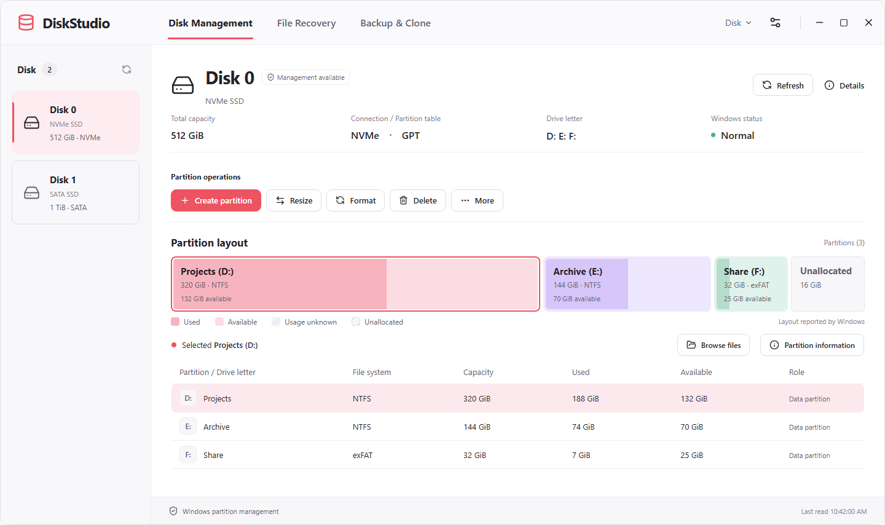

# DiskStudio

**English** · [简体中文](README.zh-CN.md)

DiskStudio is a Windows tool for disk management, file recovery, and backups. Use the partition map, file browser, and operation previews to inspect drives, manage partitions, recover files, and create backups.

This is an early preview. Back up important data and verify the selected drive before changing partitions, formatting, restoring, or cloning.

Download the Windows x64 portable ZIP from [GitHub Releases](https://github.com/ylzz1997/DiskStudio/releases), extract it, and open `DiskStudio.exe`. The app requires Microsoft Edge WebView2 Runtime.



## Features

| Feature                    | What you can do                                                                                                                                                                  |
| -------------------------- | -------------------------------------------------------------------------------------------------------------------------------------------------------------------------------- |
| Disk management            | Inspect disks, partitions, and volumes. Create and delete ordinary GPT data partitions, change volume labels and drive letters, and resize the end of supported NTFS partitions. |
| Formatting                 | Format as NTFS, FAT12/16/32, exFAT, supported Ext variants, or single-device Btrfs. Choose quick or full formatting, cluster sizes, and NTFS options where available.                |
| File browsing and recovery | Browse supported file systems, scan for deleted file candidates or file signatures, filter, preview, and export files, and save or resume scan progress.                         |
| Backup and restore         | Create full or incremental backups with Zstd compression and password protection. Browse backups, extract files, and restore to a target of matching capacity.                   |
| Disk and partition cloning | Copy every sector or copy used space, with readback verification.                                                                                                                |
| Image browsing             | Open RAW/IMG files and supported VHD, VHDX, VDI, VMDK, and Parallels HDD variants in read-only mode.                                                                             |
| Disk tools                 | Back up and check partition tables, view SMART data for supported devices, run surface read scans, view and search sectors, benchmark drives, and wipe data.                     |

Available operations depend on the state of the disk, partition type, and file system. The app explains why an operation is unavailable when it can determine the reason.

## Getting started

DiskStudio runs on Windows x64 and requires Microsoft Edge WebView2 Runtime. After extracting the portable package or building from source, open `DiskStudio.exe`.

Choose your display language in **Settings**.

- In **Disk Management**, select a disk on the left, then select a partition in the map or table to see its actions. Use the **Disk** menu to open or close images or refresh the disk list.
- In **File Recovery**, choose the source and scan mode. After scanning, filter and preview candidates, then export selected files to another physical disk.
- In **Backup & Clone**, select a backup, restore, or clone operation. Review the source, target, capacity, and options in the preview before confirming.

Save backups to another physical disk to protect the source.

## Supported operations and limits

- **Partition operations** primarily support ordinary GPT data partitions. System, boot, hidden, and read-only partitions have additional restrictions. NTFS resizing changes the end boundary while keeping the start fixed.
- **Quick partitioning** previews batch creation and formatting. It deletes only partitions you explicitly select that pass the protection checks.
- **FAT and exFAT resizing** changes the end of supported GPT data partitions. Shrinking can move occupied tail clusters into free space before the new boundary. Growing uses adjacent unallocated space and expands the FAT and moves the data area when necessary. exFAT adjusts the size of its allocation bitmap. The disk stays offline after the operation.
- **Ext formatting and resizing** are limited to supported Linux data partitions. Resizing requires a clean, unmounted file system and changes only the end boundary.
- **Btrfs** supports single-device volumes using CRC32C, xxHash64, SHA-256, or BLAKE2b-256, with Zlib, LZO, and Zstd file extraction. Deleted-file candidates come from verifiable read-only snapshots or retained transactions. Supported GPT Linux data partitions can be formatted with CRC32C or resized at their end boundary. Shrinking can relocate SINGLE and DUP stripes that cross the new boundary. Each moved stripe needs a contiguous unallocated range within that boundary. Stripes with superblock reservations must stay in place.
- **Multi-device Btrfs** supports browsing, previews, and file recovery from explicitly selected member partitions. Supported profiles are SINGLE, DUP, RAID0, RAID1, RAID1C3, RAID1C4, RAID10, RAID5, and RAID6. Select all members for a normal read. Degraded read is opt-in and uses the available members and redundant stripes to read data that can be independently checksum-verified. RAID5 tolerates one unavailable stripe per row and RAID6 tolerates two. File availability also depends on the metadata and data profiles of the affected block groups. Export to a separate physical disk.
- **Btrfs used-space backup and cloning** check allocation on clean single-device SINGLE and DUP volumes, including volumes with a separate block-group tree. Superblock reservations, metadata, system groups and allocated data are retained. Multi-device members are copied sector by sector.
- **Lost Btrfs partitions** can be found from primary or backup superblocks after verifying the member bounds, chunk mapping, device extents and root directory. Browse and extract checksum-verified files directly from the found range. Restoring a Linux data entry to an intact GPT requires a current, usable primary superblock and a non-overlapping range.
- **Lost Btrfs member groups** can be browsed together using candidates from recent searches on the same or different disks. A member with a valid superblock and system stripe bounds may need other members before its directory can be verified. Select candidates from the same committed filesystem. Exports go to a disk outside the selected group.
- **LVM2 logical volumes** can be opened from File Recovery by selecting physical-volume partitions or disks. In Backup & Clone → Browse Images, select member partitions within an opened disk image or select standalone RAW/IMG physical-volume files together. DiskStudio checks committed volume-group metadata and maps linear, striped and supported RAID volumes for read-only browsing, previews and file extraction. RAID reads require all members by default. Supported RAID10 layouts include near, far and offset with verified dm-raid metadata. With degraded reads enabled, RAID1 and RAID10 require at least one surviving copy of each logical stripe. RAID4/5 tolerate one missing member and RAID6 tolerates two. RAID0 requires every member. Degraded exports record their source condition and require independent content verification. Physical-volume members can span disks. Export to a disk outside the entire source group. The export report records the volume group, logical volume and physical member ranges, or the corresponding image files and ranges. Deleted-file scanning can recover candidates verified against supported filesystem history, including Btrfs read-only snapshots.
- **LVM2 thin volumes and thin snapshots** use the committed thin-pool metadata and their own block maps. Browsing requires the pool data and metadata members, consistent transaction IDs, and valid mapping and allocation records. The selected snapshot exposes the files recorded in that snapshot.
- **LVM2 persistent copy-on-write snapshots** can be browsed, previewed and exported with the required members selected. DiskStudio reads saved chunks from the snapshot store and the remaining ranges from its origin. Sparse snapshots use zeroes for untouched ranges. Invalid snapshots and snapshots involved in a merge are unavailable.
- **Virtual RAID** in Backup & Clone → Browse image assembles explicitly ordered RAW/IMG member files using their byte offsets, lengths, logical sector size, and stripe size. It supports JBOD, RAID0, RAID1, near RAID10 with two copies, RAID4, four rotating RAID5 layouts plus fixed last parity, and three DDF RAID6 layouts. Supported redundant layouts can read with members explicitly marked missing if every required stripe is recoverable. Browse a supported filesystem or a validated GPT/MBR partition map, then preview and export files to a separate physical disk. Mirror reads compare surviving copies. When every parity member is present, sampled stripe checks can detect inconsistencies. Confirm member order and layout independently. The export report records the settings and member ranges.
- **File recovery** depends on the state of the original data. Overwriting, TRIM, fragmentation, and metadata damage can make a candidate unrecoverable. EFS, deleted Ext files, and general fragmented file reconstruction are unsupported.
- **Cloning and restoring** require matching scope, capacity, and sector geometry as applicable. Resizing during cloning and system migration are unsupported. A destination may remain offline after writing. The app leaves duplicate disk identifiers inactive.
- **Image browsing** is read-only. Support varies by container variant, snapshot chain, and encryption format.
- **Interrupted operations** may leave changes in place. If a job fails or you cancel it, check which steps completed and inspect the target before proceeding.

## Build from source

### Requirements

- Windows x64.
- Node.js 22.12 or a later supported LTS version, with npm.
- Stable Rust with the `x86_64-pc-windows-msvc` toolchain.
- Visual Studio C++ Build Tools with the Desktop development with C++ workload and a Windows SDK.
- Microsoft Edge WebView2 Runtime.

See the [Tauri Windows prerequisites](https://v2.tauri.app/start/prerequisites/) for setup instructions.

### Build

Download or clone the complete source and run these commands in PowerShell from the repository root.

```powershell
npm ci
npm run tauri -- build --no-bundle
```

Tauri builds the frontend and the desktop executable. The executable is ready to run without a development server.

```text
target/release/diskstudio.exe
```

This command builds a portable executable. See the [Tauri CLI reference](https://v2.tauri.app/reference/cli/) for packaging options.

Keep `vendor/`, `third-party/`, `src-tauri/ext4-engine/`, and `src-tauri/btrfs-engine/` in the source tree. The build embeds the file system tools. Their sources, licenses, and separate build instructions are in the [e2fsprogs notes](third-party/e2fsprogs/README.md) and [WinBtrfs notes](third-party/winbtrfs/README.md).
