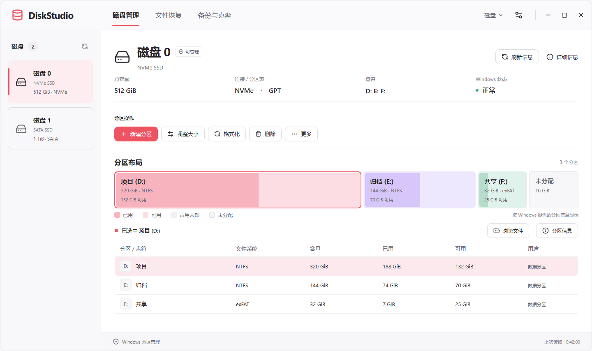

# DiskStudio

[English](README.md) · **简体中文**

DiskStudio 是一款面向 Windows 的磁盘管理、文件恢复与备份工具。通过分区图、文件列表和操作预览，查看存储设备、整理分区、提取文件和制作备份。

当前为早期预览版本。修改分区、格式化、还原和克隆前，请先备份重要数据，并核对所选设备。



## 功能

| 功能           | 支持内容                                                                                              |
| -------------- | ----------------------------------------------------------------------------------------------------- |
| 磁盘管理       | 查看磁盘、分区与卷信息，创建和删除普通 GPT 数据分区，修改卷标与盘符，在支持范围内调整 NTFS 分区末端   |
| 格式化         | NTFS、FAT12/16/32、exFAT、受支持的 Ext 文件系统和单设备 Btrfs。在支持的文件系统上可选择快速或完整格式化、簇大小及部分 NTFS 选项 |
| 文件浏览与恢复 | 浏览受支持文件系统的目录，查找删除文件候选和文件签名，筛选、预览并导出文件，保存和载入扫描进度        |
| 备份与还原     | 完整与增量备份、Zstd 压缩、密码保护、备份内容浏览及文件提取、同容量还原                               |
| 磁盘与分区克隆 | 逐扇区或按已用空间复制，完成后读回校验                                                                |
| 镜像浏览       | 只读打开 RAW/IMG，以及受支持的 VHD、VHDX、VDI、VMDK 和 Parallels HDD 镜像变体                         |
| 磁盘工具       | 分区表备份与检查、受支持设备的 SMART 信息、表面读取扫描、扇区查看与搜索、测速和数据清除               |

具体可用操作取决于磁盘状态、分区类型和文件系统。界面会显示不支持或不可操作的原因。

## 使用

运行环境为 Windows x64，并需要 Microsoft Edge WebView2 Runtime。构建或解压程序后，运行 `DiskStudio.exe`。可以在 **设置** 中切换界面语言。

- **磁盘管理**：从左侧选择磁盘，在分区图或表格中选中分区，再选择对应操作。通过顶部“磁盘”菜单打开、关闭镜像或刷新设备列表。
- **文件恢复**：选择来源和扫描方式，开始扫描后筛选、预览候选文件，再将选中文件导出到另一块物理磁盘。
- **备份与克隆**：选择备份、还原或克隆，核对来源、目标、容量和选项，查看操作预览后确认执行。

扫描和数据任务需要手动启动。恢复导出与备份应使用另一块物理磁盘，避免覆盖源数据。

## 支持范围与限制

- **分区操作**：主要面向普通 GPT 数据分区；系统、启动、隐藏、只读等受保护目标会限制操作。NTFS 调整容量只改变分区末端，不移动起点。
- **快速分区**：支持批量预览、创建和格式化。仅删除明确勾选且通过保护检查的数据分区。
- **FAT 与 exFAT 缩放**调整受支持的 GPT 数据分区末端。缩容可将尾部占用簇搬到新边界以内的空闲位置。扩容使用相邻的未分配空间，必要时扩大 FAT 并搬移数据区。exFAT 会调整分配位图大小。操作后磁盘保持脱机。
- **Ext 文件系统**：格式化与末端调整仅适用于受支持、干净卸载的普通 Linux 数据分区；不会因分区类型是 Linux 就认定其中存在 Ext 文件系统。
- **Btrfs** 支持使用 CRC32C、xxHash64、SHA-256 或 BLAKE2b-256 的单设备卷，可提取 Zlib、LZO 和 Zstd 压缩的文件。删除候选来自可核对的只读快照或保留事务。受支持的 GPT Linux 数据分区可格式化为 CRC32C 卷或调整末端。缩容可以搬移越界的 SINGLE 和 DUP 条带。每条待搬条带需要新边界内一段连续的未分配空间，含超级块保留区的条带须留在原位。
- **多设备 Btrfs** 可显式选择成员分区来浏览、预览和恢复文件。支持 SINGLE、DUP、RAID0、RAID1、RAID1C3、RAID1C4、RAID10、RAID5 和 RAID6。默认要求选齐成员。用户可启用缺盘读取，从现有成员和冗余条带读取通过独立校验的数据。RAID5 每行可容忍一条不可用条带，RAID6 可容忍两条。文件能否提取还取决于相关元数据和数据块组的冗余配置。文件导出到另一块物理盘。
- **Btrfs 已用空间备份和克隆** 支持检查干净卸载的单设备 SINGLE 和 DUP 卷，包括使用独立块组树的卷。保留超级块预留区、元数据、系统块组和已分配数据。多设备成员逐扇区复制。
- **Btrfs 丢失分区** 可通过主超级块或备用超级块搜索。核对成员边界、块组映射、设备范围和根目录后，可直接浏览并提取通过校验的文件。恢复 Linux 数据分区条目要求主超级块与当前提交一致、候选范围无重叠，并且 GPT 完整。
- **丢失的 Btrfs 成员组** 可从同一磁盘或不同磁盘最近的搜索结果中选择候选并联合浏览。超级块和系统条带有效的成员可以先保留为候选，目录可能需要选齐其他成员才能核对。所选成员须来自同一提交，导出目标须避开所有源盘。
- **LVM2 逻辑卷** 可从「文件恢复」选择物理卷所在的分区或磁盘。在「备份与克隆 → 浏览镜像」中，也可选择已打开的整盘镜像内的成员分区，或一次选齐独立的 RAW/IMG 物理卷文件。DiskStudio 校验已提交的卷组元数据，为线性、条带和支持的 RAID 卷建立只读映射，可浏览、预览及提取文件。RAID 默认要求成员齐全。RAID10 支持通过 dm-raid 元数据核对的 near、far 和 offset 布局。显式允许缺盘读取后，已同步的 RAID1 和 RAID10 要求每段逻辑条带至少有一个可用副本。RAID4/5 可缺一个成员，RAID6 可缺两个。RAID0 仍须选齐。缺盘导出会记录来源状态，文件内容需独立核对。物理卷成员可分布在不同磁盘。导出目标必须避开所有源盘。清单记录卷组、逻辑卷和物理成员范围，镜像导出记录来源文件与范围。删除扫描可从受支持的文件系统历史中核对候选，例如 Btrfs 只读快照。
- **LVM2 薄置备卷与薄置备快照** 按已提交的薄池元数据和各自的块映射只读访问。浏览要求薄池的数据、元数据成员齐全，事务号一致，映射和分配记录均通过校验。选择快照后可浏览其中保留的文件。
- **LVM2 持久化写时复制快照** 在选齐成员后可只读浏览、预览和导出。已保存的数据块从快照存储读取，其余范围从原卷读取。稀疏快照的未写入范围返回零值。失效或正在合并的快照不可读取。
- **文件恢复**：发现候选文件不代表内容完整。覆盖、TRIM、碎片和元数据损坏可能导致无法恢复；EFS、Ext 删除恢复及通用碎片重组不受支持。
- **克隆与还原**：要求符合对应操作的范围、容量和扇区大小约束，不支持自动缩放克隆或系统迁移。写入目标可能保持脱机，不会自动激活重复的磁盘标识。
- **镜像**：以只读方式打开；并非每种容器变体、快照链或加密格式都受支持。
- **操作中断**：失败或取消不等于回滚。请根据结果检查已完成的步骤及目标状态。

## 从源码构建

### 环境要求

在 Windows x64 上准备：

- Node.js 22.12 或更新的受支持 LTS 版本，以及 npm。
- Rust stable，使用 `x86_64-pc-windows-msvc` 工具链。
- Visual Studio C++ Build Tools，安装“使用 C++ 的桌面开发”及 Windows SDK。
- Microsoft Edge WebView2 Runtime。

环境安装说明可参考 [Tauri Windows 前置要求](https://v2.tauri.app/zh-cn/start/prerequisites/)。

### 构建步骤

下载或克隆完整源码，在项目根目录打开 PowerShell：

```powershell
npm ci
npm run tauri -- build --no-bundle
```

该命令会先构建前端，再生成桌面程序。默认产物位置：

```text
target/release/diskstudio.exe
```

构建完成后可直接运行，无需启动前端开发服务器。上述命令生成可执行文件，不生成安装包；`--no-bundle` 的说明见 [Tauri 命令行文档](https://v2.tauri.app/reference/cli/)。

请保留源码包中的 `vendor/`、`third-party/`、`src-tauri/ext4-engine/` 和 `src-tauri/btrfs-engine/` 目录。文件系统工具会嵌入桌面程序。工具来源、许可证和单独构建说明见 [e2fsprogs 说明](third-party/e2fsprogs/README.md) 和 [WinBtrfs 说明](third-party/winbtrfs/README.md)。
